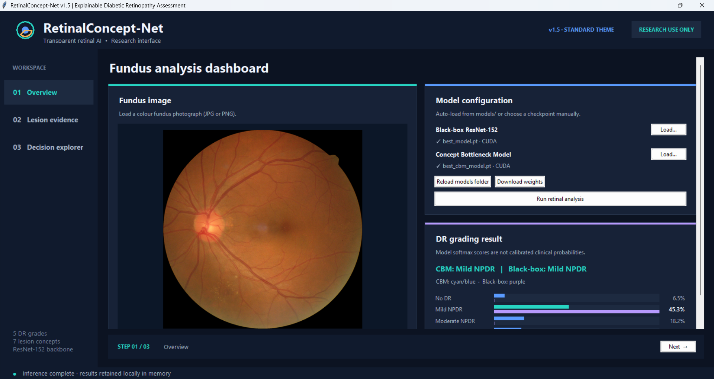

# RetinaConcept-Net GUI

This repository contains the research application and graphical user interface (GUI) for **[RetinaConcept-Net](https://github.com/AliGolbaf/retinaconcept-net)**, a concept bottleneck model developed for explainable diabetic retinopathy (DR) grading using colour fundus images.

## Features

### 1. Overview

The **Overview** tab provides the main interface for retinal image analysis and diabetic retinopathy (DR) grading.

- Import colour fundus photographs for analysis.
- Load the black-box ResNet-152 classifier and/or RetinaConcept-Net.
- Automatically detect and load trained checkpoints from the `models/` directory.
- Download missing model weights or manually select checkpoints.
- Display predicted DR grades and their corresponding classification scores.
- Compare predictions from the black-box classifier and RetinaConcept-Net.



### 2. Lesion Evidence Explorer

The **Lesion Evidence Explorer** tab provides spatial and concept-level explanations of RetinaConcept-Net predictions.

- Visualise the seven predicted retinal lesion concepts:
  - Microaneurysms (MA)
  - Hard exudates (HE)
  - Intraretinal haemorrhages (IH)
  - Venous beading / Intraretinal microvascular abnormalities (VB/IRMA)
  - Neovascularisation (NV)
  - Vitreous haemorrhage (VH)
  - Retinal detachment (RD)
- Inspect the predicted probability of each clinical concept.
- Visualise spatial evidence heatmaps overlaid on the original fundus photograph.
- Adjust heatmap opacity and evidence thresholds for visual inspection.

**Note:** The heatmaps represent learned spatial evidence rather than validated pixel-level lesion segmentations.


### 3. Concept Bottleneck Decision Explorer

The **Concept Bottleneck Decision Explorer** tab provides an interpretable breakdown of how RetinaConcept-Net reaches its DR grading decision.

- **Signed concept contributions:** Visualise the individual contributions of the seven predicted concepts to the logit margin between the predicted grade and the runner-up grade.
- **Case-level explanations:** Generate textual explanations identifying the clinical concepts supporting or opposing the predicted grade.
- **What-if analysis:** Interactively modify individual concept probabilities and observe their effects on the trained linear grading classifier.
- **Prediction sensitivity:** Examine how changes in concept values influence the predicted DR grade and classification scores.
- **Export results:** Save classification probabilities and concept-level outputs in JSON format.

**Note:** The what-if analysis modifies the inputs to the trained grading classifier without rerunning the image-based concept extractor. These experiments demonstrate model sensitivity rather than causal or clinical effects.


## Requirements

- Python **3.10 or newer**.
- NumPy, Pillow, PyTorch and torchvision, as specified in `requirements.txt`.
- **Tkinter**, which is normally included in Python for Windows; on some Linux distributions, install the system's `python3-tk` package separately.
- A genuine, architecture-compatible PyTorch checkpoint for each model you wish to run.

The initial download and installation of PyTorch dependencies may be substantial. A CUDA-enabled installation is optional; the app can run on CPU.

## Quick start (Windows)

Open PowerShell in the repository folder and run:

```powershell
py -m venv .venv
.\.venv\Scripts\python.exe -m pip install -r requirements.txt
.\run_windows.bat
```

After installation, double-click `run_windows.bat` for subsequent launches. The launcher uses `.venv` if it exists, or your system Python otherwise.

On macOS or Linux, use the corresponding virtual environment commands and launch with `python app.py`:

```bash
python3 -m venv .venv
source .venv/bin/activate
python -m pip install -r requirements.txt
python app.py
```

## Model checkpoints

Place your trained state-dictionary checkpoints in `models/` using the recommended filenames:

```text
models/
├── best_model.pt       # black-box ResNet-152
└── best_cbm_model.pt   # RetinaConcept-Net
```

The app attempts to load these automatically on startup. If they are added later, use **Reload models folder**. Alternatively, click **Load…** for a model and select a `.pt` or `.pth` checkpoint from anywhere on your computer. Manual loading also works when `models/` is empty.

The loader recognises certain alternative filenames, but it requires an unambiguous match per model type and does not select between multiple folds automatically. Checkpoints must be compatible with the architecture in `models.py` and be state dictionaries; the app does not download model weights.

You can open the interface without weights, but model inference remains unavailable until at least one checkpoint loads successfully. The black-box classifier and the concept bottleneck model can be used separately.

## Repository structure

```text
retinaconcept-net-gui/
├── app.py              # Tkinter interface
├── model_runtime.py    # checkpoint discovery, inference, and explanations
├── models.py           # PyTorch model definitions
├── requirements.txt    # Python dependencies
├── run_windows.bat     # Windows launcher
├── smoke_test.py       # tests that do not require checkpoints
├── models/             # local checkpoints; ignored by Git
├── .gitignore
└── README.md
```

The interface optionally uses the **Azure ttk theme** when `azure/azure.tcl` and its companion files are present. This optional third-party theme is **not included** in this repository. Without it, the application uses its built-in fallback theme; some controls may look different from a themed local installation.

## Check the project

Run these tests after installing NumPy:

```bash
python -m unittest smoke_test -v
```

The tests cover checkpoint discovery, numerical probability calculations, and the exact reconstruction of the linear classifier's logit margin. They do **not** check trained-model accuracy or load checkpoints.

## Interpretation and limitations

- Classification scores are softmax outputs, **not calibrated clinical probabilities**.
- Spatial concept maps are model evidence activations, **not validated lesion segmentations**.
- The *what-if* controls evaluate the trained linear grading head using modified concept values; they do not rerun the image model and do not support causal or clinical intervention claims.
- Any real-world use requires independent clinical and external validation, appropriate governance, and regulatory assessment.

## Licence

Copyright © 2026 Ali Golbaf. No open-source licence has yet been specified; permission to reuse or redistribute the code is not implied by public availability. Choose and add a `LICENSE` file before inviting outside contributions or reuse.
