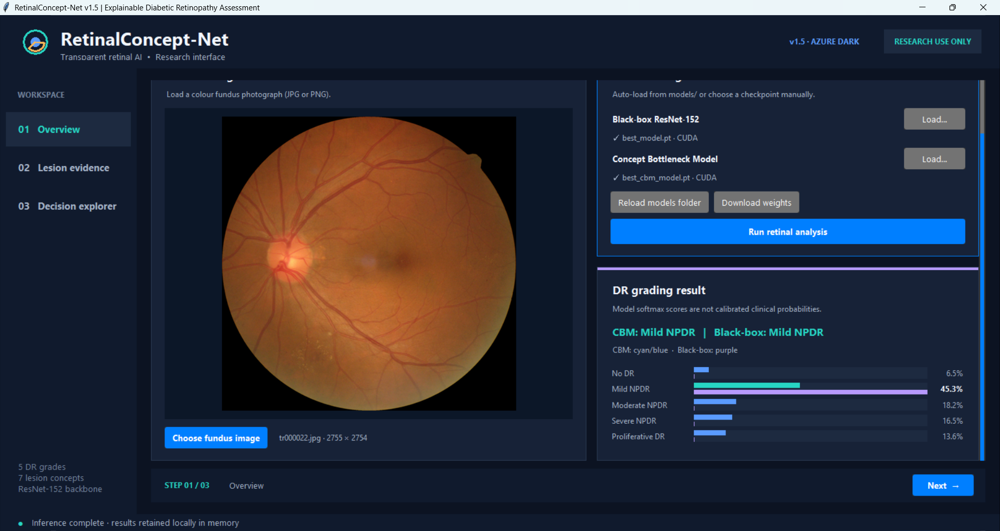
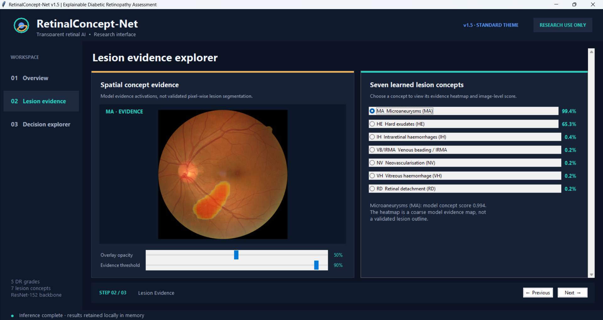
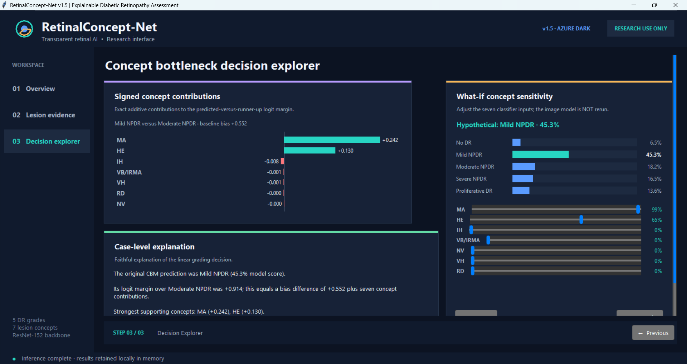

# RetinaConcept-Net GUI

This repository contains the research application and graphical user interface (GUI) for **[RetinaConcept-Net](https://github.com/AliGolbaf/retinaconcept-net)**, a concept bottleneck model developed for explainable diabetic retinopathy (DR) grading using colour fundus images.

### ✨ Features

#### 1. Overview

The **Overview** tab provides the main interface for retinal image analysis and diabetic retinopathy (DR) grading.

- Import colour fundus photographs for analysis.
- Load the black-box ResNet-152 classifier and/or RetinaConcept-Net.
- Automatically detect and load trained checkpoints from the `models/` directory.
- Download missing model weights or manually select checkpoints.
- Display predicted DR grades and their corresponding classification scores.
- Compare predictions from the black-box classifier and RetinaConcept-Net.

#### 2. Lesion Evidence Explorer

The **Lesion Evidence Explorer** tab provides spatial and concept-level explanations of RetinaConcept-Net predictions.

- Visualise the seven predicted retinal lesion concepts:
  - Microaneurysms (MA)
  - Hard exudates (HE)
  - Intraretinal haemorrhages (IH)
  - Venous beading / Intraretinal microvascular abnormalities (VB/IRMA)
  - Neovascularisation (NV)
  - Vitreous haemorrhage (VH)
  - Retinal detachment (RD)
- Inspect the predicted probability of each clinical concept.
- Visualise spatial evidence heatmaps overlaid on the original fundus photograph.
- Adjust heatmap opacity and evidence thresholds for visual inspection.

**Note:** The heatmaps represent learned spatial evidence rather than validated pixel-level lesion segmentations.

#### 3. Concept Bottleneck Decision Explorer

The **Concept Bottleneck Decision Explorer** tab provides an interpretable breakdown of how RetinaConcept-Net reaches its DR grading decision.

- **Signed concept contributions:** Visualise the individual contributions of the seven predicted concepts to the logit margin between the predicted grade and the runner-up grade.
- **Case-level explanations:** Generate textual explanations identifying the clinical concepts supporting or opposing the predicted grade.
- **What-if analysis:** Interactively modify individual concept probabilities and observe their effects on the trained linear grading classifier.
- **Prediction sensitivity:** Examine how changes in concept values influence the predicted DR grade and classification scores.
- **Export results:** Save classification probabilities and concept-level outputs in JSON format.

**Note:** The what-if analysis modifies the inputs to the trained grading classifier without rerunning the image-based concept extractor. These experiments demonstrate model sensitivity rather than causal or clinical effects.

### 🗂️ Repository files

| File / Folder | Description |
| --- | --- |
| `app.py` | Main Tkinter graphical user interface |
| `model_runtime.py` | Model loading, inference, and concept-level explanations |
| `model_download.py` | Automatic download of trained model checkpoints from Google Drive |
| `models.py` | Original black-box ResNet-152 and RetinaConcept-Net architectures |
| `requirements.txt` | Python dependencies |
| `run_windows.bat` | Windows launcher for the application |
| `smoke_test.py` | Unit tests that do not require trained model checkpoints |
| `models/` | Local storage for trained model checkpoints |
| `azure/` | Azure ttk theme files for the graphical interface |
| `screenshots/` | Screenshots of the three application tabs |
| `.gitignore` | Git exclusions for model weights, datasets, and temporary files |
| `README.md` | Project documentation and installation instructions |

